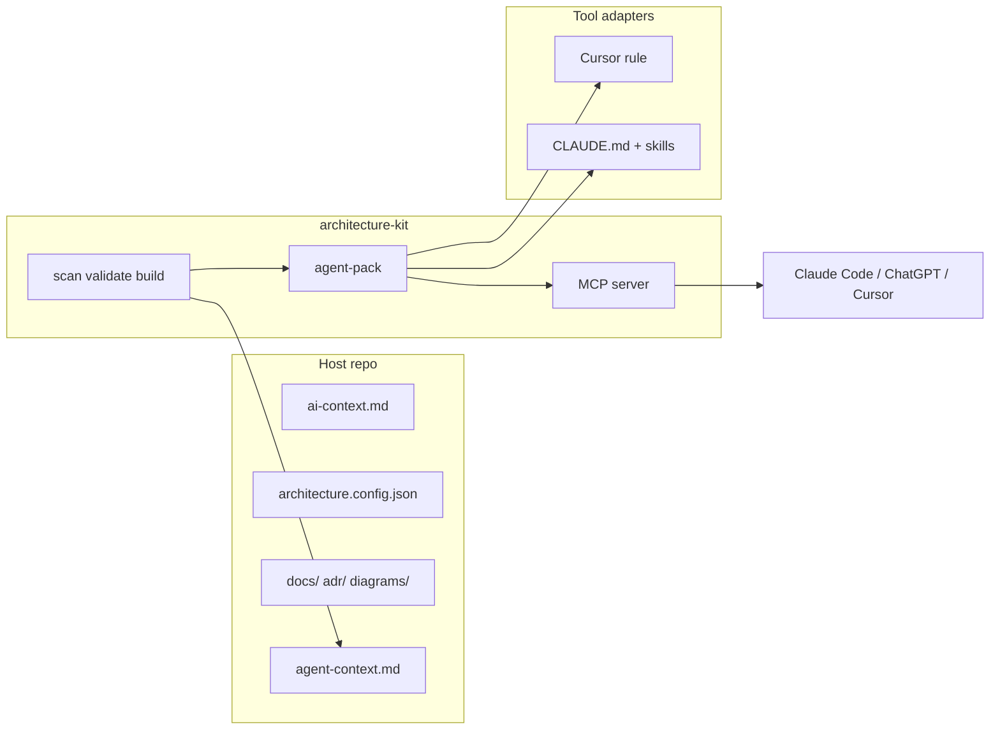

# Architecture Kit — Roadmap

Repo-native system architecture docs for any project. This file extends the checklist in [README.md](./README.md) with **agent integration** work and notes from competitive research ([tela / telawiki.com](https://telawiki.com/)).

---

## Completed

- [x] **Phase 1** — Scaffold (`init`, templates, embed scripts)
- [x] **Phase 2** — Docs site (`dev`, `build`, Markdown + Mermaid sources)
- [x] **Phase 3** — Validation (`validate`, `doctor`, placeholders)
- [x] **Phase 4** — Project type detection (`detect`)
- [x] **Phase 5** — PR change awareness (`validate --since`)
- [x] **Phase 6** — AI tooling sync (Cursor rule, `AGENTS.md` template)
- [x] **Phase 7** — Link + Mermaid validation, site search, dates, `scan` / `bootstrap`
- [x] **Phase 7b** — Scaffold mode (frontmatter on `.md` / `.mmd`, nav markers, `--ci` guards, greenfield prompt)
- [x] **Phase 10** — Agent pack (v0.5.2)
- [x] **Phase 11** — Claude/Cursor tool adapters (v0.5.4)
- [x] **Phase 12** — MCP stdio server (v0.5.3) — [templates/mcp/README.md](./templates/mcp/README.md)
- [x] **Phase 13** — Coverage report / `doctor --json` (v0.5.4)
- [x] **Phase 15** — Configurable paths & mount (v0.5.5)
- [x] **Phase 16** — Deploy safety (v0.5.6)
- [x] **Phase 17** — npm registry publish + v1.0.0 reset (in progress — publish pending)

---

## In progress / next

### Phase 17 — npm registry & v1.0.0 baseline 🔄

Move from git SSH branch pins to **GitHub Packages** as the default install path. Reset version line: `0.5.x` was pre-release agent-pack work; **1.0.0** is the first stable registry release.

- [x] Bump `package.json` to **1.0.0**
- [x] Embed template: `"@folklore/architecture-kit": "^1.0.0"` (not `git+ssh://...`)
- [x] [PUBLISHING.md](./PUBLISHING.md) + [VERSIONING.md](./VERSIONING.md) — registry auth, migration checklist
- [ ] **`npm publish`** to GitHub Packages (maintainer PAT)
- [ ] Merge `feature/agent-pack` → `main`, tag `v1.0.0`
- [ ] Host repos: add `.npmrc`, replace `#feature/agent-pack` git pin with `^1.0.0`

See [.npmrc.example](./.npmrc.example).

### Phase 8 — Convention checks
Optional ESLint or custom rules wired through `architecture.config.json` (component registry, import boundaries). Complements manual `component-conventions.md`.

### Phase 9 — WordPress embed
`--embed wordpress-custom` (Sage/Bud static mount).

---

## Agent-native docs (new track)

Goal: **same repo-native docs**, but agents (Claude Code, Cursor, ChatGPT) get a **stable contract** — not copy-paste prompts that drift between Help, scan output, and IDE rules.



### Phase 10 — Agent pack (kit) ✅ (v0.5.2)
**Emit a versioned bundle** on `scan` and/or `build`:

| Artifact | Purpose |
|----------|---------|
| `.architecture-kit/agent-context.md` | Already exists — brownfield checklist from repo scan |
| `.architecture-kit/agent-pack.json` | Machine-readable: config summary, doc index, governance rules, kit version |
| `.architecture-kit/prompts/greenfield.md` | Same text as Help / home (single source) |
| `.architecture-kit/prompts/brownfield-doc-update.md` | When to update which architecture pages after code changes |
| Copy of `search-index.json` | Fast local search without rebuilding site |

**Host repo:** no new files required; optional commit of `agent-pack.json` if teams want pinned agent context in PRs.

### Phase 11 — Tool adapters (templates) ✅ (v0.5.4)
Thin, tool-specific layers — **not** duplicated prompts:

| Adapter | Deliverable |
|---------|-------------|
| Cursor | `.cursor/rules/architecture-kit.mdc` (exists) → reference `agent-pack.json` |
| Claude Code | `CLAUDE.md` + `.claude/skills/architecture-kit/SKILL.md` templates |
| Generic | `AGENTS.md` template (optional track in git; some repos gitignore it) |

Skills encode: reading order (`ai-context` → relevant page → code), when to run `validate`, brownfield vs greenfield flows.

### Phase 12 — MCP server (kit) ✅ (v0.5.3)
Optional package: `@folklore/architecture-kit/mcp` or `architecture-kit mcp`.

**Design:** reads **repo on disk** (not a hosted wiki). Works in Claude Code, Cursor, any MCP client.

| Tool | Behavior |
|------|----------|
| `architecture_get_context` | `ai-context.md` + parsed `architecture.config.json` + agent-pack |
| `architecture_search` | Query `search-index.json` or scan `docs/` |
| `architecture_get_page` | Return one page by relative path |
| `architecture_list_pages` | Doc index with scaffold flags |
| `architecture_list_gaps` | Wrapper around gaps report (scaffold, warnings) |
| `architecture_validate` | Run validate; return structured issues |

Full setup and smoke tests: **[templates/mcp/README.md](./templates/mcp/README.md)**.

**Non-goals for MCP:** write docs autonomously without human review; replace git as source of truth.

### Phase 13 — Architecture coverage report (kit) ✅ (v0.5.4)
Inspired by tela Atlas **coverage %**, but scoped to **architecture governance**, not full codebase surface:

- Integrations in config ↔ mentioned in `integrations.md` and ADRs
- Env keys in `.env.example` ↔ `environments.md`
- Diagrams present ↔ linked from overview / documentation-map
- Scaffold / placeholder / broken link counts

Output: `architecture-kit doctor --json` or `coverage` subcommand — **named gaps**, not a vague “AI wrote something.”

### Phase 14 — Semantic search (optional)
Site search today is **keyword** over `search-index.json`. Optional hybrid retrieval (heading-aware chunks + embeddings) for Ask-docs UX — only if teams want in-app Q&A; MCP + Claude may make this lower priority.

---

## Developer FAQ (host repos)

Questions from teams adopting the kit — **what works today** vs **planned**.

### Why `.architecture-kit/` instead of `node_modules/`?

Two different things:

| Location | What it is |
|----------|------------|
| `node_modules/@folklore/architecture-kit` | The **npm/git package** — CLI, validators, site builder, MCP server (same as any dependency). |
| `.architecture-kit/` | **Generated output in the host repo** — `agent-context.md`, `agent-pack.json`, prompts, optional `search-index.json`. Written by `scan`, `bootstrap`, and site build. |

We use `.architecture-kit/` (like `.next/` or `dist/`) so agent artifacts are **project-local, git-optional, and readable without digging into `node_modules`**. MCP and IDE tools point at repo paths, not package internals.

**Today:** agent output path is fixed at `.architecture-kit/`.  
**Roadmap (Phase 15):** optional `paths.agentOutput` in config; clearer docs in Help + init output.

### Can we change the docs root away from `docs/`?

**Yes — today.** `architecture.config.json` → `paths`:

```json
{
  "paths": {
    "docs": "documentation",
    "architectureDocs": "documentation/architecture",
    "adr": "documentation/adr",
    "diagrams": "documentation/diagrams",
    "aiContext": "documentation/architecture/ai-context.md"
  }
}
```

Validators, site build, scan, and MCP respect these paths when config is loaded.

**Gaps:** embed scripts still assume default layout in a few host-side constants; templates from `init` always scaffold under `docs/`.  
**Roadmap (Phase 15):** `init`/`bootstrap` honor existing `paths.*`; embed scripts read mount/output from config (see below).

### Can we configure the served URL (not `/architecture/`)?

**Partially today.** Next.js embed rewrites links to a mount path, but it is **hardcoded in project scripts**, not config:

- `scripts/embed-architecture-site.mjs` → `ARCHITECTURE_MOUNT = "/architecture/"`
- `next.config.ts` → `ARCHITECTURE_DOCS_PATH = "/architecture"`
- Built files → `public/architecture/` (also hardcoded in `build-architecture-site.mjs`)

Changing the URL requires editing those three places consistently (`templates/embed/nextjs/EMBED.md` documents this).

**Roadmap (Phase 15):** add optional `site` fields, e.g.:

```json
{
  "site": {
    "mountPath": "/internal/architecture/",
    "outputDir": "public/architecture"
  }
}
```

Kit `build` emits a small manifest; embed scripts read it so mount path and output dir stay in **one config file**.

### Should `public/architecture/` be gitignored?

**Recommended yes** — built HTML is generated on `dev` / `build-dev`, not source of truth.

**Today:** `templates/embed/nextjs/EMBED.md` says to add `/public/architecture/` manually. Host example [rock-em-sock-em](https://github.com/Folklore-Digital/rock-em-sock-em) gitignores both `.architecture-kit/` and `/public/architecture/`.

**Roadmap (Phase 15):**

- `init --embed` appends output dir to `.gitignore` when safe (no duplicate lines)
- `validate` warns if built docs path is tracked in git (`git ls-files`)
- Help page calls out “source = markdown in git; built site = local/CI only unless you explicitly deploy it”

### WordPress: keep architecture files off production

WordPress deploys often sync **the whole theme** or use **All-in-One WP Migration** / FTP “upload everything”. Architecture markdown and built HTML are **internal engineering docs** — they should not ship to public production unless deliberately exposed.

**Today:** no WordPress embed template yet (Phase 9). Custom themes can keep docs outside `wp-content/themes/.../public` or exclude paths in deploy scripts — manual discipline only.

**Roadmap (Phase 9 + Phase 16 — deploy safety):**

| Mechanism | Purpose |
|-----------|---------|
| `--embed wordpress-custom` | Sage/Bud-style static mount with **config-driven output dir** outside web root when possible |
| `.distignore` / deploy exclude list | Template excludes `docs/`, `.architecture-kit/`, built architecture HTML from rsync/FTP/deploy hooks |
| All-in-One WP Migration exclude patterns | Document (or script) paths to exclude from migration packages |
| `governance.docsProductionExposure` | `"none"` (default) \| `"dev-only"` \| `"public"` — validate fails if production exposure is `"none"` but deploy config would publish doc paths |
| CI deploy artifact check | Optional `architecture-kit validate --deploy-artifact <dir>` — fail if forbidden paths appear in what would go live |

**Principle:** markdown sources may live in the repo git ships to production (private repos); **built static site and agent pack** should default to **dev/staging-only** or auth-gated routes — never accidental directory listing on a public WordPress host.

### Security: architecture docs must not leak to live servers

**Today:**

- Folklore Next.js hosts serve `/architecture/` on **dev** (e.g. fklr.dev) by choice; production exposure is a **host-app decision** (redirect, auth middleware, or omit from prod build).
- No kit-enforced production block yet.

**Roadmap (Phase 16 — deploy & exposure governance):**

1. **Config:** `site.exposure`: `"local"` \| `"dev-staging"` \| `"production"` — documents intent; validate reminds when `"production"` + sensitive env docs exist.
2. **Next.js:** template middleware snippet to 404 `/architecture/` in production when `exposure !== "production"`.
3. **WordPress:** docs outside document root; `.htaccess` deny rules template for any built HTML under theme.
4. **Validate:** integration with deploy configs (Vercel `vercel.json`, Netlify `_redirects`, WP `.distignore`) — warn when architecture output is not excluded from prod.
5. **No secrets in architecture docs** — extend validate to flag env var *values* or credential patterns in markdown (already partially covered via `.env.example` ↔ `environments.md` cross-check).

**Non-goal:** the kit cannot prevent a team from FTP-uploading arbitrary folders; we provide **defaults, templates, and CI checks** so the safe path is obvious.

---

## Phase 15 — Configurable paths & mount ✅ (v0.5.5)

Unify host-side hardcoding into `architecture.config.json`:

- [x] `site.mountPath`, `site.outputDir` (Next.js embed scripts read config + embed manifest)
- [x] `paths.agentOutput` (default `.architecture-kit`)
- [x] `init --embed` writes gitignore entries for output + agent dirs
- [x] `validate` warns when built output is git-tracked
- [x] Kit `build` writes `.architecture-kit/embed-manifest.json` for embed scripts

## Phase 16 — Deploy safety & production exposure ✅ (v0.5.6)

- [x] `site.exposure` + `governance.docsProductionExposure` config
- [x] Next.js `middleware.architecture-docs.example.ts` + deploy-safety templates (WordPress `.distignore`, AIOWM excludes, Apache deny)
- [x] `validate --deploy-artifact` for CI pipelines
- [x] Validate: gitignore/deploy exclusions, secret patterns in architecture docs
- [ ] WordPress `--embed` (Phase 9 — separate)

## Phase 17 — npm registry & v1.0.0 baseline 🔄

- [x] Version reset: `0.5.x` → **1.0.0** (first stable registry release)
- [x] `templates/embed/nextjs/package.merge.json` — npm semver default
- [x] `publish:github` script; `prepublishOnly` via publish script
- [x] Host migration docs in [PUBLISHING.md](./PUBLISHING.md)
- [ ] Publish `@folklore/architecture-kit@1.0.0` to GitHub Packages
- [ ] Migrate host repos from git branch pins

---

## Comparison: Architecture Kit vs [tela (telawiki.com)](https://telawiki.com/)

Both target **agents + docs**. They solve different problems.

| Dimension | **tela** | **Architecture Kit** |
|-----------|----------|----------------------|
| **Primary product** | Hosted team wiki (+ self-host AGPL) | Git-native docs layer in each repo |
| **Doc source of truth** | tela Postgres (`pages.body` markdown) | `docs/` in git |
| **Generation** | **Atlas** auto-writes wiki from git/Jira; coverage % with `file:line` citations; drift probes ~15 min | **Human + agent** fill scaffold; `scan`/`bootstrap` assist; **validate** enforces consistency |
| **Scope of docs** | Broad team wiki (runbooks, product, engineering) | **System architecture** only — structure, deploy, integrations, ADRs; tickets stay in Monday/Jira |
| **Agent connection** | MCP at `telawiki.com/api/mcp` — 39 tools; OAuth; read/write wiki from Claude/ChatGPT | Cursor rule; scan agent-context; MCP stdio server (repo-local, read-first) |
| **Search** | Hybrid keyword + vector (`pgvector`); “ask your docs” with citations | Static site search index; no embedded LLM |
| **Editing** | Real-time block editor, comments, wikilinks, WebDAV sync | Edit markdown in git; optional `/architecture/` embed in host app |
| **Governance** | Space roles, SSO, audit (Enterprise) | `architecture.config.json` — integrations require docs/ADR, scaffold blocks CI, env var docs |
| **Hosting** | SaaS or Docker self-host | Built into host app (`public/architecture/`) or standalone `architecture-kit dev` |

### What we can glean from tela ( adopt / adapt / avoid )

**Adopt (ideas)**

1. **MCP as first-class agent API** — agents shouldn’t rely on pasted context; tools for search, get page, get context.
2. **Named gaps, not fuzzy completeness** — tela’s “92% covered, missing `POST /deploy/rollback` at handlers/deploy.go:212” parallels our validate errors/warnings; extend with an explicit **coverage report** for architecture obligations.
3. **Heading-aware chunks for retrieval** — if we add semantic search, chunk by heading (their Ask-docs approach).
4. **Scoped agent credentials** — read-only vs read-write keys per space; we can document read-only MCP / validate-only CI tokens for host repos.
5. **Single connector URL story** — “Claude Code, Cursor, same MCP endpoint” — matches our `run-architecture-kit.mjs` + future MCP.

**Adapt (same idea, different shape)**

1. **Atlas auto-generation** → our **`scan` + `bootstrap` + greenfield prompt`** — agent fills docs from codebase, but pages live in **git** and go through PR review, not a separate wiki DB.
2. **Ask your docs** → **Claude/Cursor with MCP** over repo markdown — no hosted LLM meter; BYO model (aligns with tela’s “bring your own agent unlimited”).
3. **Drift detection** → **`validate --since origin/develop`** + optional CI — regenerate/freshness is human/agent triggered, not 15-minute probes (architecture docs change less often than code surface).
4. **Wikilinks / backlinks** → internal link validation + future site backlink panel (nice-to-have).

**Avoid ( intentional non-goals )**

1. **Replacing Monday/Jira/feature specs** — our `documentation-map.md` is explicit: one fact, one owner.
2. **Auto-overwriting docs on every git push** — architecture docs are **curated**; validate blocks bad merges instead of silent regeneration.
3. **Full team wiki / Notion replacement** — no block editor, spreadsheets, presentations; Storybook + Monday stay in their lanes.
4. **Hosted doc SaaS as kit default** — Folklore ships docs **inside** the app (`/architecture/`); tela-style hosting is a different product if ever needed.

### Positioning one-liner

- **tela:** “Team wiki that writes itself; agents read/write the wiki in Claude.”
- **Architecture Kit:** “Architecture docs that live in git; agents follow `ai-context` and validate before merge.”

Complementary, not competitive — a team could use tela for runbooks and Architecture Kit for repo-native system architecture, or use only the kit if architecture stays in-repo (Folklore’s model).

---

## Suggested implementation order

1. **Phase 10** — agent-pack generation (low risk, fixes prompt drift immediately)
2. **Phase 11** — Claude Code skill + `CLAUDE.md` templates (no new runtime)
3. **Phase 12** — MCP read tools (`get_context`, `search`, `get_page`)
4. **Phase 13** — coverage report in `doctor`
5. Phase 8, 9, 14 as capacity allows
6. **Phase 15** — configurable mount/output paths + gitignore on init
7. **Phase 16** — deploy safety (WordPress exclusions, prod exposure governance)
8. **Phase 17** — npm registry publish + v1.0.0 baseline

---

## References

- [tela homepage](https://telawiki.com/) — agent-native wiki, Atlas, MCP connector
- Host example: [rock-em-sock-em](https://github.com/Folklore-Digital/rock-em-sock-em) — `/architecture/` embed, `feature/arch-docs-build`
- Kit releases: tag `vX.Y.Z` in this repo only ([VERSIONING.md](./VERSIONING.md))
