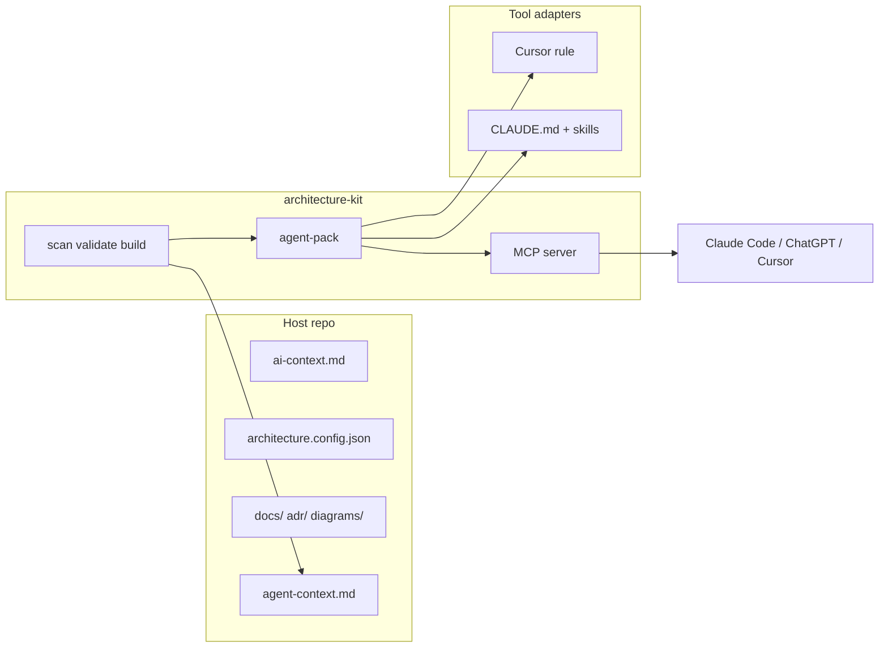

# Architecture Kit — Roadmap

Repo-native system architecture docs for any project. This file extends the checklist in [README.md](./README.md) with **agent integration** work and notes from competitive research ([tela / telawiki.com](https://telawiki.com/)).

---

## Completed

- [x] **Phase 1** — Scaffold (`init`, templates, embed scripts)
- [x] **Phase 2** — Docs site (`dev`, `build`, Markdown + Mermaid sources)
- [x] **Phase 3** — Validation (`validate`, `doctor`, placeholders)
- [x] **Phase 4** — Project type detection (`detect`)
- [x] **Phase 5** — PR change awareness (`validate --since`)
- [x] **Phase 6** — AI tooling sync (Cursor rule, `AGENTS.md` template)
- [x] **Phase 7** — Link + Mermaid validation, site search, dates, `scan` / `bootstrap`
- [x] **Phase 7b** — Scaffold mode (frontmatter on `.md` / `.mmd`, nav markers, `--ci` guards, greenfield prompt)

---

## In progress / next

### Phase 8 — Convention checks
Optional ESLint or custom rules wired through `architecture.config.json` (component registry, import boundaries). Complements manual `component-conventions.md`.

### Phase 9 — WordPress embed
`--embed wordpress-custom` (Sage/Bud static mount).

---

## Agent-native docs (new track)

Goal: **same repo-native docs**, but agents (Claude Code, Cursor, ChatGPT) get a **stable contract** — not copy-paste prompts that drift between Help, scan output, and IDE rules.

### Phase 10 — Agent pack (kit) ✅ (v0.5.2)
**Emit a versioned bundle** on `scan` and/or `build`:

| Artifact | Purpose |
|----------|---------|
| `.architecture-kit/agent-context.md` | Already exists — brownfield checklist from repo scan |
| `.architecture-kit/agent-pack.json` | Machine-readable: config summary, doc index, governance rules, kit version |
| `.architecture-kit/prompts/greenfield.md` | Same text as Help / home (single source) |
| `.architecture-kit/prompts/brownfield-doc-update.md` | When to update which architecture pages after code changes |
| Copy of `search-index.json` | Fast local search without rebuilding site |

**Host repo:** no new files required; optional commit of `agent-pack.json` if teams want pinned agent context in PRs.

### Phase 11 — Tool adapters (templates)
Thin, tool-specific layers — **not** duplicated prompts:

| Adapter | Deliverable |
|---------|-------------|
| Cursor | `.cursor/rules/architecture-kit.mdc` (exists) → reference `agent-pack.json` |
| Claude Code | `CLAUDE.md` + `.claude/skills/architecture-kit/SKILL.md` templates |
| Generic | `AGENTS.md` template (optional track in git; some repos gitignore it) |

Skills encode: reading order (`ai-context` → relevant page → code), when to run `validate`, brownfield vs greenfield flows.

### Phase 12 — MCP server (kit)
Optional package: `@folklore/architecture-kit/mcp` or `architecture-kit mcp`.

**Design:** reads **repo on disk** (not a hosted wiki). Works in Claude Code, Cursor, any MCP client.

| Tool (proposed) | Behavior |
|-----------------|----------|
| `architecture_get_context` | `ai-context.md` + parsed `architecture.config.json` |
| `architecture_search` | Query `search-index.json` or scan `docs/` |
| `architecture_get_page` | Return one page by relative path |
| `architecture_list_gaps` | Wrapper around `doctor` / validate summary (integrations, scaffold, placeholders) |
| `architecture_validate` | Run validate; return structured issues (optional, powerful) |

**Non-goals for MCP:** write docs autonomously without human review; replace git as source of truth.

### Phase 13 — Architecture coverage report (kit)
Inspired by tela Atlas **coverage %**, but scoped to **architecture governance**, not full codebase surface:

- Integrations in config ↔ mentioned in `integrations.md` and ADRs
- Env keys in `.env.example` ↔ `environments.md`
- Diagrams present ↔ linked from overview / documentation-map
- Scaffold / placeholder / broken link counts

Output: `architecture-kit doctor --json` or `coverage` subcommand — **named gaps**, not a vague “AI wrote something.”

### Phase 14 — Semantic search (optional)
Site search today is **keyword** over `search-index.json`. Optional hybrid retrieval (heading-aware chunks + embeddings) for Ask-docs UX — only if teams want in-app Q&A; MCP + Claude may make this lower priority.

---

## Comparison: Architecture Kit vs [tela (telawiki.com)](https://telawiki.com/)

Both target **agents + docs**. They solve different problems.

| Dimension | **tela** | **Architecture Kit** |
|-----------|----------|----------------------|
| **Primary product** | Hosted team wiki (+ self-host AGPL) | Git-native docs layer in each repo |
| **Doc source of truth** | tela Postgres (`pages.body` markdown) | `docs/` in git |
| **Generation** | **Atlas** auto-writes wiki from git/Jira; coverage % with `file:line` citations; drift probes ~15 min | **Human + agent** fill scaffold; `scan`/`bootstrap` assist; **validate** enforces consistency |
| **Scope of docs** | Broad team wiki (runbooks, product, engineering) | **System architecture** only — structure, deploy, integrations, ADRs; tickets stay in Monday/Jira |
| **Agent connection** | MCP at `telawiki.com/api/mcp` — 39 tools; OAuth; read/write wiki from Claude/ChatGPT | Cursor rule; scan agent-context; **MCP planned** (repo-local, read-first) |
| **Search** | Hybrid keyword + vector (`pgvector`); “ask your docs” with citations | Static site search index; no embedded LLM |
| **Editing** | Real-time block editor, comments, wikilinks, WebDAV sync | Edit markdown in git; optional `/architecture/` embed in host app |
| **Governance** | Space roles, SSO, audit (Enterprise) | `architecture.config.json` — integrations require docs/ADR, scaffold blocks CI, env var docs |
| **Hosting** | SaaS or Docker self-host | Built into host app (`public/architecture/`) or standalone `architecture-kit dev` |

### What we can glean from tela ( adopt / adapt / avoid )

**Adopt (ideas)**

1. **MCP as first-class agent API** — agents shouldn’t rely on pasted context; tools for search, get page, get context.
2. **Named gaps, not fuzzy completeness** — tela’s “92% covered, missing `POST /deploy/rollback` at handlers/deploy.go:212” parallels our validate errors/warnings; extend with an explicit **coverage report** for architecture obligations.
3. **Heading-aware chunks for retrieval** — if we add semantic search, chunk by heading (their Ask-docs approach).
4. **Scoped agent credentials** — read-only vs read-write keys per space; we can document read-only MCP / validate-only CI tokens for host repos.
5. **Single connector URL story** — “Claude Code, Cursor, same MCP endpoint” — matches our `run-architecture-kit.mjs` + future MCP.

**Adapt (same idea, different shape)**

1. **Atlas auto-generation** → our **`scan` + `bootstrap` + greenfield prompt`** — agent fills docs from codebase, but pages live in **git** and go through PR review, not a separate wiki DB.
2. **Ask your docs** → **Claude/Cursor with MCP** over repo markdown — no hosted LLM meter; BYO model (aligns with tela’s “bring your own agent unlimited”).
3. **Drift detection** → **`validate --since origin/develop`** + optional CI — regenerate/freshness is human/agent triggered, not 15-minute probes (architecture docs change less often than code surface).
4. **Wikilinks / backlinks** → internal link validation + future site backlink panel (nice-to-have).

**Avoid ( intentional non-goals )**

1. **Replacing Monday/Jira/feature specs** — our `documentation-map.md` is explicit: one fact, one owner.
2. **Auto-overwriting docs on every git push** — architecture docs are **curated**; validate blocks bad merges instead of silent regeneration.
3. **Full team wiki / Notion replacement** — no block editor, spreadsheets, presentations; Storybook + Monday stay in their lanes.
4. **Hosted doc SaaS as kit default** — Folklore ships docs **inside** the app (`/architecture/`); tela-style hosting is a different product if ever needed.

### Positioning one-liner

- **tela:** “Team wiki that writes itself; agents read/write the wiki in Claude.”
- **Architecture Kit:** “Architecture docs that live in git; agents follow `ai-context` and validate before merge.”

Complementary, not competitive — a team could use tela for runbooks and Architecture Kit for repo-native system architecture, or use only the kit if architecture stays in-repo (Folklore’s model).

---

## Suggested implementation order

1. **Phase 10** — agent-pack generation (low risk, fixes prompt drift immediately)
2. **Phase 11** — Claude Code skill + `CLAUDE.md` templates (no new runtime)
3. **Phase 12** — MCP read tools (`get_context`, `search`, `get_page`)
4. **Phase 13** — coverage report in `doctor`
5. Phase 8, 9, 14 as capacity allows

---

## References

- [tela homepage](https://telawiki.com/) — agent-native wiki, Atlas, MCP connector
- Host example: [rock-em-sock-em](https://github.com/Folklore-Digital/rock-em-sock-em) — `/architecture/` embed, `feature/arch-docs-build`
- Kit releases: tag `vX.Y.Z` in this repo only ([VERSIONING.md](./VERSIONING.md))
